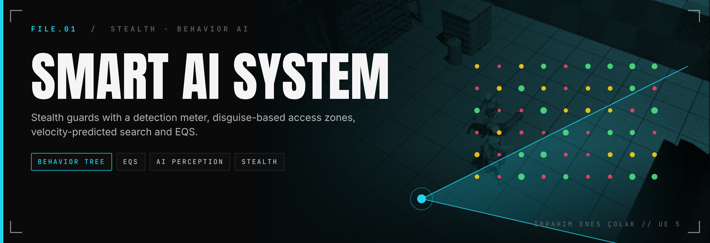
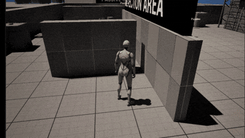
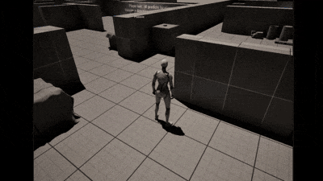
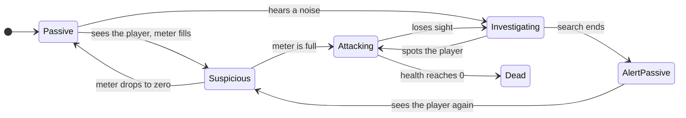
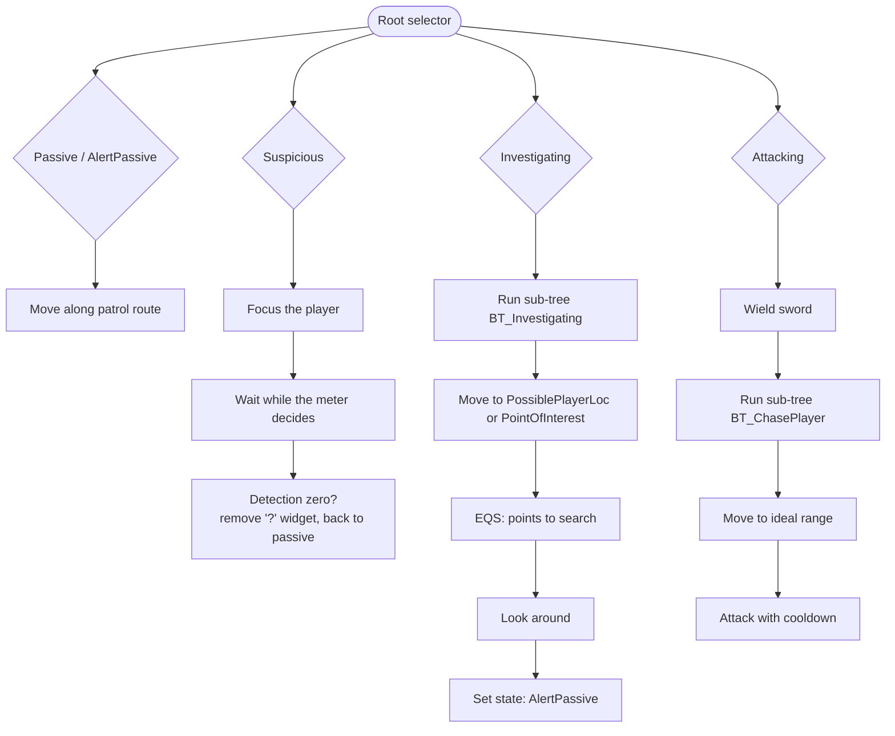

<p align="center">
  
</p>

<p align="center">
  
  
  
</p>

<p align="center">
  <a href="https://www.ibrahimenescolak.com"><b>Portfolio</b></a> ·
  <a href="https://www.linkedin.com/in/ibrahim-enes-%C3%A7olak-b18327316">LinkedIn</a> ·
  <a href="https://qpayk.itch.io">itch.io</a>
</p>

# UE5 Smart AI System

A stealth enemy for Unreal Engine 5.7, built with a **Behavior Tree**, **AI Perception** and **EQS**. Guards don't spot the player instantly: a detection meter fills while they can see you, they get suspicious, go to check, and if they lose you they **predict where you were heading** from your velocity and search there. Restricted areas and **disguises** decide who is allowed where. Everything is in Blueprints.

<table>
<tr>
<td width="50%"></td>
<td width="50%"></td>
</tr>
<tr>
<td align="center"><sub><b>Patrol → attack.</b> Passive patrol, then EQS positioning around the target (green points score higher).</sub></td>
<td align="center"><sub><b>Search.</b> After losing sight, the guard heads for the player's predicted location and searches the maze.</sub></td>
</tr>
</table>

## Behavior states



**Passive** guards patrol. **Suspicious** guards stop and stare while the detection meter decides. **Investigating** guards walk to the noise or to the predicted location and look around. **Attacking** guards draw the sword and fight. After a search they don't go back to normal but to **AlertPassive**, so a second sighting escalates faster. `Frozen` and `Dead` exist for scripted moments and death. The current state is the `E_State_AI_2` enum in the Blackboard, and the Behavior Tree picks a branch by reading it.

## How it works

| Part | What it does |
|---|---|
| **Perception** (`AIC_Basic_Enemy2`) | Sight, hearing and damage senses. `HandledToSight`, `HandledToHearing` and `HandledToDamaged` turn each stimulus into a state change. |
| **Detection meter** | While the player is in view, `DetectionIncrease` fills a meter faster the closer the player is; out of view `DetectionDicrease` drains it. `WBP_DetectionBar` and a "?" / "!" widget above the guard show it. |
| **Prediction** | When sight is lost, the controller calculates the player's **possible future location** from their velocity and stores it as `PossiblePlayerLoc`; the investigate branch searches there. Sounds store `PointOfInterest` instead. |
| **Access zones and disguise** | `BP_AreaZone` volumes are marked **Public, Staff, Guard or Hostile** (`E_AccessState`). The player's disguise (`SetDisguise` / `GetDisguise`) is compared with the zone, so the same player is ignored in one room and hunted in the next. |
| **Calling for help** | `BTT_MessageToAI` sends an AI message to the nearest guard (`BTD_HasNearestAI`), so one alert can pull in a second enemy. |
| **Behavior Tree** (`BT_Basic_Enemy2`) | One branch per state, with sub-trees `BT_Investigating` and `BT_ChasePlayer`. |
| **EQS** | `EQS_InvestigatePlace` picks points to search around the target location, `EQS_LookCover` looks for cover, `EQS_AI_2` positions the guard in combat. |
| **Combat** | `BTT_WieldSword_2` / `BTT_SteahltSword_2` draw and sheathe the sword, `BTT_MoveToIdealRange` keeps distance, `BTT_Attack_2` swings, with a Cooldown decorator. |
| **Movement** | `E_MovementState_2`: Idle, Walk, Alert Walk, Jogging, Sprinting, set per state by `BTT_SetMovementState_2`. |

### Behavior Tree, simplified



## Project layout

```
Content/
├── _System2/                    the stealth AI shown above
│   ├── Enemy/BP_Enemy2          guard character
│   ├── Enemy/AI/
│   │   ├── AIC_Basic_Enemy2     perception, detection meter, prediction
│   │   ├── BT_Basic_Enemy2, BB_Basic_Enemy2, SubTress/
│   │   ├── Tasks/, Decorator/, EQS/, Enum/
│   │   ├── Actor/               BP_AreaZone, BP_SuspiciousWidget, patrol route
│   │   └── Widget/              detection bar, suspicious icon
│   └── Player/BP_Player2        disguise and noise
├── _System/                     first version (simpler Behavior Tree enemy)
└── ThirdPerson/Second_AI_Self   test map
```

## Running it

1. Install **Unreal Engine 5.7**, clone the repo and open `AI_MySelf_Showcase.uproject`.
2. Add the Epic mannequins: **Add → Add Feature or Content Pack → Third Person**, or copy `Content/Characters/Mannequins` from any UE 5.7 Third Person project.
3. Props, animations, sounds and voice lines come from third-party Fab packs whose licences do not allow sharing them, so they are **not in this repo** (the folders are listed in `.gitignore`). Without them every Blueprint, the Behavior Tree and the EQS queries still open and can be read; meshes, montages and sounds show up as missing references.
4. Open `Content/ThirdPerson/Second_AI_Self` and press **Play**.

<br>

## More UE5 work

<table>
<tr>
<td width="50%"><a href="https://github.com/ibrahim0enes/UE5-Smart-AI-System"></a></td>
<td width="50%"><a href="https://github.com/ibrahim0enes/UE5-Medieval-Combat-System"></a></td>
</tr>
<tr>
<td width="50%"><a href="https://github.com/ibrahim0enes/UE5-Health-Damage-System"></a></td>
<td width="50%"><a href="https://github.com/ibrahim0enes/UE5-Boxer-Enemy-AI"></a></td>
</tr>
</table>


## Credits

- Code, Blueprints, Behavior Tree and EQS: İbrahim Enes Çolak
- Props, animations, sounds and voice lines: third-party Fab packs (not included)
- Mannequins, level prototyping and template content: Epic Games, Unreal Engine Third Person template
