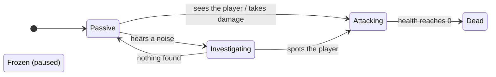
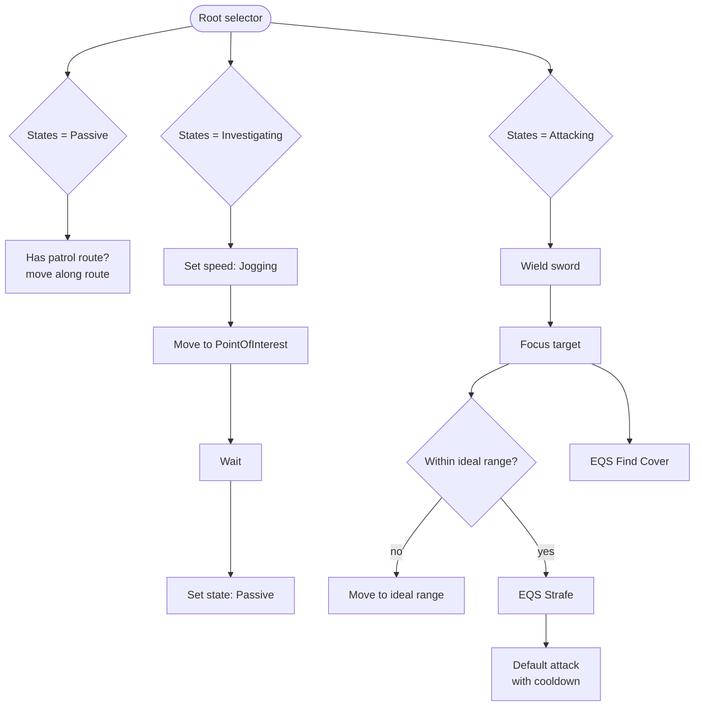

<p align="center">
  
</p>

<p align="center">
  
  
  
</p>

<p align="center">
  <a href="https://www.ibrahimenescolak.com"><b>Portfolio</b></a> ·
  <a href="https://www.linkedin.com/in/ibrahim-enes-%C3%A7olak-b18327316">LinkedIn</a> ·
  <a href="https://qpayk.itch.io">itch.io</a>
</p>

# UE5 Smart AI System

A sword-wielding enemy for Unreal Engine 5.7, built with a **Behavior Tree**, **Blackboard**, **AI Perception** and **EQS**. The enemy patrols, hears noises and goes to check them, spots the player, draws its sword, keeps an ideal fighting distance, strafes around the player and looks for cover. Everything is in Blueprints.

<table>
<tr>
<td width="50%"></td>
<td width="50%"></td>
</tr>
<tr>
<td align="center"><sub><b>Patrol → attack.</b> Passive patrol, then EQS strafing around the target (green points score higher).</sub></td>
<td align="center"><sub><b>Investigate.</b> The enemy heads for where it last sensed the player and searches the maze.</sub></td>
</tr>
</table>

## Five behavior states



The current state lives in the Blackboard as the `E_AIStates` enum (**Passive, Investigating, Attacking, Frozen, Dead**). The Behavior Tree picks a branch by reading it, so one value change in the controller is enough to switch the whole behavior.

## How it works

| Part | What it does |
|---|---|
| **Perception** (`AIC_Enemy_Base`) | An `AIPerception` component with sight, hearing and damage senses. `OnPerceptionUpdated` finds which sense fired and calls `SetStateAsAttacking`, `SetStateAsInvestigating` or `SetStateAsPassive`. |
| **Blackboard** (`BB_Enemy_Base`) | `States`, `AttackTarget`, `PointOfInterest`, `AttackRadius`, `DefendRadius`. |
| **Behavior Tree** (`BT_Enemy_Base`) | One branch per state, guarded by Blackboard decorators. |
| **Patrol** | `BTD_HasPatrolRoute` + `BTT_moveAlongPatrolRoute` walk the enemy along a `BP_PatrolRoute` placed in the level. |
| **Investigate** | Moves to the `PointOfInterest` (where the noise came from), looks around, then `BTT_SetStateAsPassive`. |
| **Attack** | `BTT_WieldSword` draws the sword (and `BTT_SteahltSword` puts it away), `BTT_FocusTarget` locks the enemy's focus, `BTT_MoveToIdealRange` keeps distance, `BTT_DefaultAttack` swings with a Cooldown decorator. |
| **EQS** | `EQS_Strafe` scores points around the target for circling, `EQS_FindCover` looks for points out of the player's line of sight, `EQS_Context_AttackTarget` feeds the target into both queries. |
| **Movement speed** | `BTT_SetMovementSpeed` switches between Idle, Walk, Jogging and Sprinting (`E_MovementSpeed`) through the `BPI_EnemyAI` interface. |
| **Interface** (`BPI_EnemyAI`) | `GetPatrolRoute`, `GetIdealRange`, `SetMovementSpeed`, so the tree never casts to a specific enemy class. |

### Behavior Tree, simplified



## Project layout

```
Content/
├── Enemies/
│   ├── BP_Enemy_Base           enemy character
│   └── AI/
│       ├── AIC_Enemy_Base      controller + AI Perception
│       ├── BT_Enemy_Base, BB_Enemy_Base
│       ├── BPI_EnemyAI, BP_PatrolRoute
│       ├── Tasks/              BTT_* (attack, focus, patrol, speed, sword)
│       ├── Decorators/         BTD_HasPatrolRoute, BTD_IsWieldingSword, BTD_IsWithinIdealRange
│       ├── EQS/                EQS_Strafe, EQS_FindCover, EQS_Context_AttackTarget
│       └── Enums/              E_AIStates, E_AISense, E_MovementSpeed
├── Player/BP_Player            reports noise and damage to the AI
├── Weapons/BP_Sword
└── ThirdPerson/                template level and game mode
```

## Running it

1. Install **Unreal Engine 5.7** and clone the repo, then open `Smart_AI.uproject`.
2. Add the Epic mannequins: **Add → Add Feature or Content Pack → Third Person**, or copy `Content/Characters/Mannequins` from any UE 5.7 Third Person project.
3. The sword and combat animations come from third-party Fab packs whose licences do not allow sharing them, so they are **not in this repo**. Without them the Blueprints, Behavior Tree and EQS assets all open and can be read, but the montages show up as missing references.
4. Place a `NavMeshBoundsVolume`, drop `BP_Enemy_Base` into the level (optionally with a `BP_PatrolRoute`), and press **Play**.

<br>

## More UE5 work

<table>
<tr>
<td width="50%"><a href="https://github.com/ibrahim0enes/UE5-Smart-AI-System"></a></td>
<td width="50%"><a href="https://github.com/ibrahim0enes/UE5-Medieval-Combat-System"></a></td>
</tr>
<tr>
<td width="50%"><a href="https://github.com/ibrahim0enes/UE5-Health-Damage-System"></a></td>
<td width="50%"><a href="https://github.com/ibrahim0enes/UE5-Boxer-Enemy-AI"></a></td>
</tr>
</table>


## Credits

- Code, Blueprints, Behavior Tree and EQS: İbrahim Enes Çolak
- Sword and combat animations: third-party Fab packs (not included)
- Mannequins, level prototyping and template content: Epic Games, Unreal Engine Third Person template
